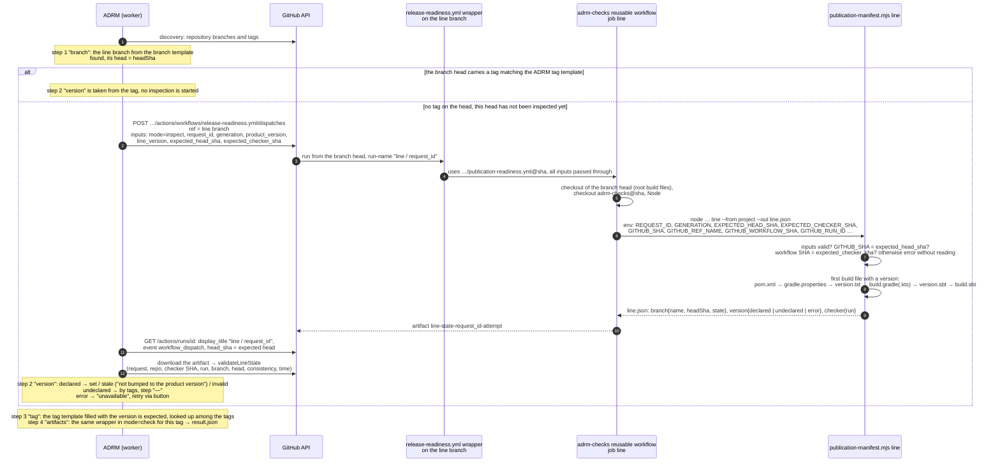

# adrm-checks

Shared publication check tooling for ADRM. A project keeps only the publication manifest `.readiness/publication.yaml`
and a thin wrapper workflow; everything else lives here and is pulled in by a pinned commit SHA.

The expected publication contents are taken from the project's own publisher, run in a sandbox (publishing is
redirected into a local directory), and stored as a list of files without versions. At check time the version is
substituted from the tag and each file is probed in the registry using the standard Maven layout. Readiness is computed
by ADRM; the report does not assert it.

## Onboarding a project

1. **Obtain the manifest.** Run the project's publish commands from its `publish.yml` once, redirected into the sandbox,
   and turn the directory into a manifest:

   ```sh
   # Maven, deploy-plugin 3.x (for 2.x the format is id::default::url, see below)
   DIR=/tmp/adrm-sandbox; mkdir -p "$DIR"
   MAVEN_OPTS="$MAVEN_OPTS -DaltDeploymentRepository=adrm-sandbox::file://$DIR -DaltReleaseDeploymentRepository=adrm-sandbox::file://$DIR -DaltSnapshotDeploymentRepository=adrm-sandbox::file://$DIR" \
     mvn <command from publish.yml, unchanged>
   node src/publication-manifest.mjs generate --from-sandbox "$DIR" --repo arenadata/<repo> --source-sha "$(git rev-parse HEAD)" --out .readiness/publication.yaml

   # Gradle
   export ADRM_SANDBOX_DIR=/tmp/adrm-sandbox
   ./gradlew <each invocation from publish.yml> -I gradle/adrm-sandbox.init.gradle
   node src/publication-manifest.mjs generate --from-sandbox "$ADRM_SANDBOX_DIR/<publishing repository name>" --repo arenadata/<repo> --source-sha "$(git rev-parse HEAD)" --invocations <number of invocations> --out .readiness/publication.yaml

   # sbt (global plugin in a separate global base so as not to touch ~/.sbt; the publish command does not change)
   mkdir -p /tmp/adrm-sbt/plugins && cp sbt/AdrmSandbox.scala /tmp/adrm-sbt/plugins/
   ADRM_SANDBOX_DIR=/tmp/adrm-sandbox sbt --batch -Dsbt.global.base=/tmp/adrm-sbt <command from publish.yml>
   node src/publication-manifest.mjs generate --from-sandbox /tmp/adrm-sandbox --repo arenadata/<repo> --source-sha "$(git rev-parse HEAD)" --out .readiness/publication.yaml
   ```

   Review the result as an ordinary diff and commit it to the project branch. If the version is already published,
   cross-check it: `verify --manifest .readiness/publication.yaml --version <version>` must yield `complete`. A stale
   manifest is caught before the release by the regeneration workflow (step 3) and pull request review; the check does
   not look for extra files in the registry.

2. **Add the wrapper** `.github/workflows/release-readiness.yml` from `examples/release-readiness.yml`, replacing
   `<commit sha of adrm-checks>` with the pinned SHA of this repository. The wrapper contains no logic: only the ADRM
   inputs and the `uses:` of the reusable workflow.The wrapper must exist on
   the default branch and on every line branch: ADRM
   dispatches it on the default branch to check the artifacts of a tag and on the line branch to inspect the declared
   version (see "Line branch inspection").

3. **Add the regeneration** `.github/workflows/publication-manifest.yml` from `examples/publication-manifest-maven.yml`,
   `-gradle.yml` or `-sbt.yml`: the same publish commands as in `publish.yml`, the `sandbox` action before them and the
   `manifest` action after. Set `timeout-minutes` to match `publish.yml` and pin `peter-evans/create-pull-request` by
   SHA. The job has only `packages: read`, so nothing can be uploaded even if the redirection is lost; the `manifest`
   action fails on an empty sandbox; the Gradle and sbt redirections fail if a task with a remote destination remains.
   The workflow opens a pull request when the file set changes and fails the pull request check if the manifest is stale.

   Maven: the redirection is added to `MAVEN_OPTS` through `GITHUB_ENV`. It overrides a job-level `MAVEN_OPTS` but not a
   step-level one; if the publish step sets `MAVEN_OPTS` in its own `env`, add the three `-Dalt…DeploymentRepository`
   properties there. On the first run confirm in the log that `Uploading to adrm-sandbox:` lines are present and no
   upload goes to the real registry.

4. **Register the repository in ADRM**: the `release-readiness.yml` workflow and the templates (ADRM defaults: branch
   `develop/<product-version>/<project-version>`, version `<project-version>-<product-version>-<fix-version>`, tag
   `v<project-version>-<product-version>-<fix-version>`; override them in the repository settings when the project
   deviates). ADRM derives the checker branch of each line from the branch template and pins its SHA for every check: a
   change to the manifest or the wrapper automatically produces a new check.

A repository that releases several lines in one product release (Hive 2.3.10.x and 4.3.0.x, Spark 3.5.4.x and 4.2.0.x)
does steps 1–3 in every line branch: the manifests differ, the commands do not. ADRM keeps one row per repository + line
pair and finds the lines from branches and tags on its own.

## Manifest format

```yaml
schema: adrm/publication-manifest/v1
project: arenadata/iceberg
registry: https://maven.pkg.github.com/arenadata/iceberg
version: from-tag
generated: { method: sandbox-publish, fromVersion: 1.10.1.1-4.3.0-3, sourceSha: …, modules: 53, primaryFiles: 312, … }
groups:
  org.apache.iceberg:
    iceberg-bom: [ .module, .pom ]
    iceberg-core: [ -javadoc.jar, -sources.jar, -tests.jar, .jar, .module, .pom ]
```

An entry is the literal file name suffix after `<artifactId>-<version>`: `.pom`, `-sources.jar`, `-bin.tar.gz`,
`.jar.asc`. All listed files are mandatory. Checksum files (`.md5`, `.sha1`, `.sha256`, `.sha512`) and
`maven-metadata.xml` are not part of the manifest: GitHub Packages serves checksums itself, and the metadata is
generated by the registry. `generated` is provenance only and does not affect the check. The file is not edited by hand;
it is regenerated.

## What happens during a check

The reusable workflow runs in the project's context: its `GITHUB_TOKEN` with `packages: read`, its workflow SHA. The
`emit` steps:

1. Validation of the ADRM inputs and that the workflow SHA matches the expected one.
2. Confirmation of the repository via the GitHub API, resolution of the tag to a commit and comparison with the ADRM
   target (`resolved`, `changed`, `missing`).
3. Expansion of the manifest into the list of files for the version, signing the contents with the same digest that ADRM
   computes.
4. HEAD for each file in the registry: 200 found, 404 not found, anything else unknown.
5. Re-resolution of the tag, writing `result.json` (ADRM contract v1) and uploading it as the
   `release-readiness-<request_id>-<attempt>` artifact.

The outcome in ADRM: `ready` only when the tag is in place, the contents are complete and every file is found; otherwise
`publication_partial`, `publication_missing`, `check_error`, `target_changed` or `not_configured`.

## Line branch inspection (`inspect` mode)

The readiness of a "repository + line" row in ADRM is made up of four steps: the line branch is created, the project
version is set, the tag is prepared, the artifacts are published. ADRM does not read the version from the branch head
itself: it runs the same wrapper on the line branch with `mode: inspect` (inputs `request_id`, `generation`,
`product_version`, `line_version`, `expected_head_sha`, `expected_checker_sha`), the reusable workflow runs `line` on a
checkout of the branch head and uploads the `line-state-<request_id>-<attempt>` artifact with `line.json` (schema
`adrm/line-state/v1`). The wrapper picks the run name by mode, `publication / <request_id>` or `line / <request_id>`,
and ADRM finds the run by it. If the branch head already carries a tag that matches the ADRM tag template, ADRM takes
the version from the tag and does not start an inspection.

How it works step by step (one run per branch head; a new head → a new inspection):



Who does what: ADRM decides whether an inspection is needed and interprets the result; the wrapper only picks the run
name and calls the reusable workflow; the reusable workflow prepares the checkout and runs the script; the script reads
the files and writes the report. Neither the script nor the wrapper parses the version: ADRM interprets it with its
version and tag templates.

`line` builds nothing: it reads the first build file that declares a version, in the order `pom.xml` (the `<version>` of
the `<project>` itself, not from `<parent>`), `gradle.properties` (`version=`), `version.txt`, `build.gradle` /
`build.gradle.kts` (`version = "…"`), `version.sbt` / `build.sbt` (`version := "…"`). The report:

```json
{
  "schemaVersion": 1,
  "executionMode": "live",
  "requestId": "<uuid>",
  "generation": 3,
  "repository": { "provider": "github", "id": 413321535, "fullName": "arenadata/hive" },
  "branch": { "name": "develop/4.4.0/4.3.0", "headSha": "<sha>", "state": "resolved" },
  "version": {
    "state": "declared",
    "value": "4.3.0.2-4.4.0-2",
    "source": { "tool": "maven", "path": "pom.xml", "method": "files" },
    "errors": []
  },
  "checker": {
    "workflowRef": "arenadata/hive/.github/workflows/release-readiness.yml@refs/heads/develop/4.4.0/4.3.0",
    "workflowSha": "<sha>",
    "runId": 1,
    "runAttempt": 1,
    "runUrl": "https://github.com/arenadata/hive/actions/runs/1"
  },
  "checkedAt": "2026-11-03T12:00:00Z"
}
```

`branch.state`: `resolved` (the head matched `expected_head_sha`) or `changed` (the head moved: the actual SHA is in
`headSha`, the version was not read, ADRM will repeat the inspection on the new head). `version.state`: `declared`;
`undeclared` (no build file declares a version; ADRM goes by the tags, the step is not red); `error` with a code in
`errors[]`: `INPUT_INVALID`, `HEAD_CHANGED`, `CHECKER_CHANGED`, `CHECKER_SETUP_ERROR`, `VERSION_READ_ERROR`. Whether the
version counts as set or as not bumped is decided by ADRM: the project version must start with the row's line, the
product version must match the release's, and the expected tag is the tag template filled with these components.

## Local usage

```sh
export GITHUB_TOKEN=<token for the GitHub API>      # reading the repository and tags
export PACKAGE_TOKEN=<token with read:packages>     # registry; falls back to GITHUB_TOKEN when absent

node src/publication-manifest.mjs verify --manifest .readiness/publication.yaml --version 1.10.1.1-4.3.0-3 --json out.json
REQUEST_ID=<uuid> GENERATION=1 GITHUB_REPOSITORY=arenadata/iceberg GITHUB_REPOSITORY_ID=<id> \
TARGET_TAG=v1.10.1.1-4.3.0-3 TARGET_SHA=<sha> TARGET_VERSION=1.10.1.1-4.3.0-3 PRODUCT_VERSION=4.3.0 \
GITHUB_WORKFLOW_REF=arenadata/iceberg/.github/workflows/release-readiness.yml@refs/heads/<branch> \
GITHUB_WORKFLOW_SHA=<sha> EXPECTED_CHECKER_SHA=<sha> GITHUB_RUN_ID=1 GITHUB_RUN_ATTEMPT=1 \
node src/publication-manifest.mjs emit --manifest .readiness/publication.yaml --out result.json --execution-mode fixture
```

`node src/publication-manifest.mjs line --from . --version-only` prints the file and the version that the branch
inspection will see, without the ADRM inputs; `line --from DIR --out line.json` with the same environment variables as
in the workflow (`GITHUB_REF_NAME`, `GITHUB_SHA`, `EXPECTED_HEAD_SHA` instead of `TARGET_*`) writes the full `line.json`.

`emit --execution-mode fixture` marks the report as local: ADRM will not accept it as live.
`--simulate <file>:missing,<file>:error` forces the observation of a single file and works only in fixture mode; this is
how negative scenarios for local replay are produced without editing reports by hand.

Maven redirection for `maven-deploy-plugin` 2.x (for example, projects on the parent POM `org.apache:apache:18`, such as
Hive): `-DaltDeploymentRepository=adrm-sandbox::default::file://$DIR`; `actions/sandbox` has `deploy-plugin-major: '2'`
for this.

## Limitations

- Registry: any Maven repository over HTTPS with the standard layout; authorization is by Bearer token only (GitHub
  Packages), Basic (Nexus) needs a small addition. Cross-checking against the registry contents is deliberately not done.
- One version for all modules of a tag; SNAPSHOTs are not supported.
- Tag, project version and branch formats are ADRM templates, overridable per repository in ADRM. The script never parses
  them: `emit` uses the tag, version and product version exactly as ADRM sends them, `line` reports the declared version
  verbatim.
- The file set is determined by the project's publisher; a file the publisher never even tried to publish cannot be
  discovered by any automatic means, which is why the manifest is reviewed by people and regeneration shows entries that
  have disappeared.
- Cross-project dependencies are not checked: `dependencies.outcome` in `result.json` is always `not_supported`.
- sbt: the standard `publish` task is redirected; `publishSigned` (sbt-pgp), sbt-sonatype and custom publish tasks are
  not covered, Ivy-style publishing is not supported.
- The inspection reads the version only from the listed build files; a version computed by the build itself (for
  example, from `git describe`) yields `undeclared`, and ADRM goes by the tags.
- YAML is read only in the subset that the generator writes.

## Versioning

Projects pin a specific commit SHA of this repository in `uses:`. Updating the tool means replacing the SHA in the
projects' wrappers; ADRM notices the change by the project's workflow SHA, so the checks rerun on their own. Before
publishing a new version: `npm test`.
