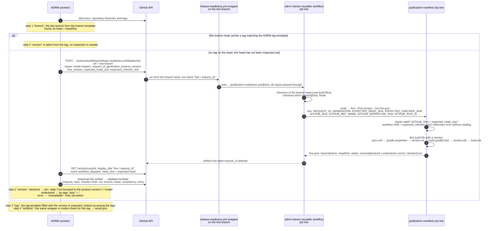
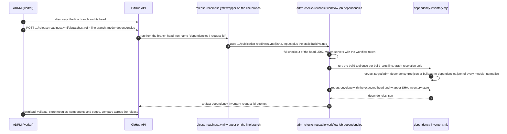
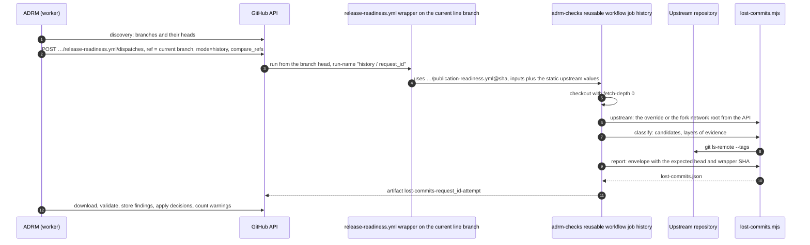

# adrm-checks

Shared publication check tooling for ADRM. A project keeps only the publication manifest `.readiness/publication.yaml`
and a thin wrapper workflow; everything else lives here and is pulled in by a pinned commit SHA. The same wrapper also
reports the declared project version of a line branch (`inspect` mode), the dependency graph of its head
(`dependencies` mode) and the commits of older line branches that its head lacks (`history` mode), so ADRM never reads
build files or history itself.

The expected publication contents are taken from the project's own publisher, run in a sandbox (publishing is
redirected into a local directory), and stored as a list of files without versions. At check time the version is
substituted from the tag and each file is probed in the registry using the standard Maven layout. Readiness is computed
by ADRM; the report does not assert it.

## Onboarding a project

1. **Obtain the manifest.** Run the project's publish commands from its `publish.yml` once, redirected into the sandbox,
   and turn the directory into a manifest:

   ```sh
   # Maven, deploy-plugin 3.x (for 2.x the format is id::default::url, see below)
   DIR=/tmp/adrm-sandbox; mkdir -p "$DIR"
   MAVEN_OPTS="$MAVEN_OPTS -DaltDeploymentRepository=adrm-sandbox::file://$DIR -DaltReleaseDeploymentRepository=adrm-sandbox::file://$DIR -DaltSnapshotDeploymentRepository=adrm-sandbox::file://$DIR" \
     mvn <command from publish.yml, unchanged>
   node src/publication-manifest.mjs generate --from-sandbox "$DIR" --repo arenadata/<repo> --source-sha "$(git rev-parse HEAD)" --out .readiness/publication.yaml

   # Gradle
   export ADRM_SANDBOX_DIR=/tmp/adrm-sandbox
   ./gradlew <each invocation from publish.yml> -I gradle/adrm-sandbox.init.gradle
   node src/publication-manifest.mjs generate --from-sandbox "$ADRM_SANDBOX_DIR/<publishing repository name>" --repo arenadata/<repo> --source-sha "$(git rev-parse HEAD)" --invocations <number of invocations> --out .readiness/publication.yaml

   # sbt (global plugin in a separate global base so as not to touch ~/.sbt; the publish command does not change)
   mkdir -p /tmp/adrm-sbt/plugins && cp sbt/AdrmSandbox.scala /tmp/adrm-sbt/plugins/
   ADRM_SANDBOX_DIR=/tmp/adrm-sandbox sbt --batch -Dsbt.global.base=/tmp/adrm-sbt <command from publish.yml>
   node src/publication-manifest.mjs generate --from-sandbox /tmp/adrm-sandbox --repo arenadata/<repo> --source-sha "$(git rev-parse HEAD)" --out .readiness/publication.yaml
   ```

   Review the result as an ordinary diff and commit it to the project branch. If the version is already published,
   cross-check it: `verify --manifest .readiness/publication.yaml --version <version>` must yield `complete`. A stale
   manifest is caught before the release by the regeneration workflow (step 3) and pull request review; the check does
   not look for extra files in the registry.

2. **Add the wrapper** `.github/workflows/release-readiness.yml` from `examples/release-readiness.yml`, replacing
   `<commit sha of adrm-checks>` with the pinned SHA of this repository. The wrapper contains no logic: only the ADRM
   inputs, the `uses:` of the reusable workflow and the static `build_*` values of the project for the dependency
   inventory (build tool, launcher, JDK, the flags and profiles of `publish.yml`, the Maven server ids; see "Dependency
   inventory"). The wrapper must exist on the default branch and on every line branch: ADRM dispatches it on the default
   branch to check the artifacts of a tag and on the line branch to inspect the declared version, to read the
   dependency graph and to look for lost commits. Check the build values once before the first run:
   `node src/dependency-inventory.mjs run --tool maven --command mvn --args-file args.txt --from <checkout> --out /tmp/adrm-dependencies`.

3. **Add the regeneration** `.github/workflows/publication-manifest.yml` from `examples/publication-manifest-maven.yml`,
   `-gradle.yml` or `-sbt.yml`: the same publish commands as in `publish.yml`, the `sandbox` action before them and the
   `manifest` action after. Set `timeout-minutes` to match `publish.yml` and pin `peter-evans/create-pull-request` by
   SHA. The job has only `packages: read`, so nothing can be uploaded even if the redirection is lost; the `manifest`
   action fails on an empty sandbox; the Gradle and sbt redirections fail if a task with a remote destination remains.
   The workflow opens a pull request when the file set changes and fails the pull request check if the manifest is stale.

   Maven: the redirection is added to `MAVEN_OPTS` through `GITHUB_ENV`. It overrides a job-level `MAVEN_OPTS` but not a
   step-level one; if the publish step sets `MAVEN_OPTS` in its own `env`, add the three `-Dalt…DeploymentRepository`
   properties there. On the first run confirm in the log that `Uploading to adrm-sandbox:` lines are present and no
   upload goes to the real registry.

4. **Register the repository in ADRM**: the `release-readiness.yml` workflow and the templates (ADRM defaults: branch
   `develop/<product-version>/<project-version>`, version `<project-version>-<product-version>-<fix-version>`, tag
   `v<project-version>-<product-version>-<fix-version>`; override them in the repository settings when the project
   deviates). ADRM derives the checker branch of each line from the branch template and pins its SHA for every check: a
   change to the manifest or the wrapper automatically produces a new check.

A repository that releases several lines in one product release (Hive 2.3.10.x and 4.3.0.x, Spark 3.5.4.x and 4.2.0.x)
does steps 1–3 in every line branch: the manifests differ, the commands do not. ADRM keeps one row per repository + line
pair and finds the lines from branches and tags on its own.

## Manifest format

```yaml
schema: adrm/publication-manifest/v1
project: arenadata/iceberg
registry: https://maven.pkg.github.com/arenadata/iceberg
version: from-tag
generated: { method: sandbox-publish, fromVersion: 1.10.1.1-4.3.0-3, sourceSha: …, modules: 53, primaryFiles: 312, … }
groups:
  org.apache.iceberg:
    iceberg-bom: [ .module, .pom ]
    iceberg-core: [ -javadoc.jar, -sources.jar, -tests.jar, .jar, .module, .pom ]
```

An entry is the literal file name suffix after `<artifactId>-<version>`: `.pom`, `-sources.jar`, `-bin.tar.gz`,
`.jar.asc`. All listed files are mandatory. Checksum files (`.md5`, `.sha1`, `.sha256`, `.sha512`) and
`maven-metadata.xml` are not part of the manifest: GitHub Packages serves checksums itself, and the metadata is
generated by the registry. `generated` is provenance only and does not affect the check. The file is not edited by hand;
it is regenerated.

## What happens during a check

The reusable workflow runs in the project's context: its `GITHUB_TOKEN` with `packages: read`, its workflow SHA. The
`emit` steps:

1. Validation of the ADRM inputs and that the workflow SHA matches the expected one.
2. Confirmation of the repository via the GitHub API, resolution of the tag to a commit and comparison with the ADRM
   target (`resolved`, `changed`, `missing`).
3. Expansion of the manifest into the list of files for the version, signing the contents with the same digest that ADRM
   computes.
4. HEAD for each file in the registry: 200 found, 404 not found, anything else unknown.
5. Re-resolution of the tag, writing `result.json` (ADRM contract v1) and uploading it as the
   `release-readiness-<request_id>-<attempt>` artifact.

The outcome in ADRM: `ready` only when the tag is in place, the contents are complete and every file is found; otherwise
`publication_partial`, `publication_missing`, `check_error`, `target_changed` or `not_configured`.

## Line branch inspection (`inspect` mode)

The readiness of a "repository + line" row in ADRM is made up of four steps: the line branch is created, the project
version is set, the tag is prepared, the artifacts are published. ADRM does not read the version from the branch head
itself: it runs the same wrapper on the line branch with `mode: inspect` (inputs `request_id`, `generation`,
`product_version`, `line_version`, `expected_head_sha`, `expected_checker_sha`), the reusable workflow runs `line` on a
checkout of the branch head and uploads the `line-state-<request_id>-<attempt>` artifact with `line.json` (schema
`adrm/line-state/v1`). The wrapper picks the run name by mode, `publication / <request_id>`, `line / <request_id>` or
`dependencies / <request_id>`, and ADRM finds the run by it. If the branch head already carries a tag that matches the ADRM tag template, ADRM takes
the version from the tag and does not start an inspection.

How it works step by step (one run per branch head; a new head → a new inspection):



Who does what: ADRM decides whether an inspection is needed and interprets the result; the wrapper only picks the run
name and calls the reusable workflow; the reusable workflow prepares the checkout and runs the script; the script reads
the files and writes the report. Neither the script nor the wrapper parses the version: ADRM interprets it with its
version and tag templates.

`line` builds nothing: it reads the first build file that declares a version, in the order `pom.xml` (the `<version>` of
the `<project>` itself, not from `<parent>`), `gradle.properties` (`version=`), `version.txt`, `build.gradle` /
`build.gradle.kts` (`version = "…"`), `version.sbt` / `build.sbt` (`version := "…"`). The report:

```json
{
  "schemaVersion": 1,
  "executionMode": "live",
  "requestId": "<uuid>",
  "generation": 3,
  "repository": { "provider": "github", "id": 413321535, "fullName": "arenadata/hive" },
  "branch": { "name": "develop/4.4.0/4.3.0", "headSha": "<sha>", "state": "resolved" },
  "version": {
    "state": "declared",
    "value": "4.3.0.2-4.4.0-2",
    "source": { "tool": "maven", "path": "pom.xml", "method": "files" },
    "errors": []
  },
  "checker": {
    "workflowRef": "arenadata/hive/.github/workflows/release-readiness.yml@refs/heads/develop/4.4.0/4.3.0",
    "workflowSha": "<sha>",
    "runId": 1,
    "runAttempt": 1,
    "runUrl": "https://github.com/arenadata/hive/actions/runs/1"
  },
  "checkedAt": "2026-11-03T12:00:00Z"
}
```

`branch.state`: `resolved` (the head matched `expected_head_sha`) or `changed` (the head moved: the actual SHA is in
`headSha`, the version was not read, ADRM will repeat the inspection on the new head). `version.state`: `declared`;
`undeclared` (no build file declares a version; ADRM goes by the tags, the step is not red); `error` with a code in
`errors[]`: `INPUT_INVALID`, `HEAD_CHANGED`, `CHECKER_CHANGED`, `CHECKER_SETUP_ERROR`, `VERSION_READ_ERROR`. Whether the
version counts as set or as not bumped is decided by ADRM: the project version must start with the row's line, the
product version must match the release's, and the expected tag is the tag template filled with these components.

## Dependency inventory (`dependencies` mode)

ADRM compares dependency versions across the projects of a release: a fork's dependency on another fork against the
version the release targets for that fork, and third-party libraries (guava, netty, protobuf …) across all projects.
The facts come from the build itself. ADRM runs the same wrapper on the line branch with `mode: dependencies` (inputs
`request_id`, `generation`, `product_version`, `line_version`, `expected_head_sha`, `expected_checker_sha`; run
name `dependencies / <request_id>`), the reusable workflow resolves the dependency graph of the branch head and
uploads the `dependency-inventory-<request_id>-<attempt>` artifact with `dependencies.json` (schema
`adrm/dependency-inventory/v1`). One inventory per branch head: ADRM starts a new one when the head moves or on request.

Nothing is compiled or published. Maven runs `maven-dependency-plugin:3.11.0:tree` in every module: the goal collects
POMs and downloads no jars, so a fresh checkout at an unpublished version works, sibling `test-jar` dependencies
included. Gradle runs the `adrmDependencies` task of `gradle/adrm-dependencies.init.gradle`, which reads the
resolution result of the `compileClasspath` and `runtimeClasspath` configurations of every project (the main source
set; metadata only, no artifacts). Test, integration and jmh classpaths are left out: on Iceberg they multiply the graph
six times without changing what ships; a `build_args` line with `-Padrm.configurations=<regex>` widens the set. The
commands, one per line of `build_args`:

```sh
<mvn> -B -ntp -fae -T 1C -Dscan=false <build_args line> org.apache.maven.plugins:maven-dependency-plugin:3.11.0:tree -DoutputType=json -DoutputFile=target/adrm-dependency-tree.json -DoutputEncoding=UTF-8
<gradlew> --init-script gradle/adrm-dependencies.init.gradle --no-configuration-cache --continue <build_args line> adrmDependencies
```

The wrapper carries the project's static values: `build_tool` (`maven`, `gradle` or `sbt`), `build_command` (`mvn`,
`./mvnw`, `./build/mvn`, `./gradlew`), `java_version` (Maven: the publisher's JDK, because JDK-activated profiles change
the graph; Gradle: the highest JDK the publisher uses), `java_distribution`, `maven_server_ids` (the server ids the
build resolves from; each gets the workflow token in `~/.m2/settings.xml`) and `build_args` (the flags and profiles of
`publish.yml`, one invocation per line, no goals or tasks, no quoting). Several invocations (the Scala and Flink
variants of Iceberg) merge into one inventory by module coordinates. The job restores no Maven cache: the runner's
`~/.m2` is empty, so `mavenLocal()` (first in Iceberg's repositories) cannot shadow the registries.



The report:

```json
{
  "schemaVersion": 1,
  "executionMode": "live",
  "requestId": "<uuid>",
  "generation": 1,
  "repository": { "provider": "github", "id": 413321535, "fullName": "arenadata/hive" },
  "commit": { "ref": "refs/heads/develop/4.5.0/4.3.0", "sha": "<sha>", "state": "resolved" },
  "checker": { "workflowRef": "arenadata/hive/.github/workflows/release-readiness.yml@refs/heads/develop/4.5.0/4.3.0", "workflowSha": "<sha>", "runId": 1, "runAttempt": 1, "runUrl": "https://github.com/arenadata/hive/actions/runs/1" },
  "checkedAt": "2026-11-03T12:00:00.000Z",
  "inventory": {
    "state": "complete",
    "tool": "maven",
    "invocations": [ { "command": "mvn -B -ntp -fae -T 1C -Dscan=false -DskipTests org.apache.maven.plugins:maven-dependency-plugin:3.11.0:tree -DoutputType=json -DoutputFile=target/adrm-dependency-tree.json -DoutputEncoding=UTF-8", "exitCode": 0, "durationMs": 412000 } ],
    "modules":    [ { "id": 0, "group": "org.apache.hive", "name": "hive-common", "version": "4.3.0.3-4.5.0-0", "path": "common/pom.xml", "packaging": "jar" } ],
    "components": [ { "id": 0, "group": "org.apache.hadoop", "name": "hadoop-common", "version": "3.4.3.2-4.4.0-1", "type": "jar", "classifier": null } ],
    "edges":      [ { "module": 0, "component": 0, "scope": "compile", "configuration": null, "optional": false, "direct": true, "via": null } ],
    "counts":     { "modules": 57, "components": 1480, "edges": 17100, "invocations": 1, "failedInvocations": 0 },
    "errors":     []
  }
}
```

`commit.state`: `resolved`; `changed` (the head moved: the actual SHA is in `sha`, nothing was built); `missing`.
`inventory.state`: `complete`; `partial` (modules were read, but an invocation exited with an error, a module file was
not parsed or a Gradle configuration has unresolved entries, see `errors[]`); `error` (no module could be read, or a
gate stopped the run before the build); `unsupported` (sbt). Error codes: `INPUT_INVALID`, `HEAD_CHANGED`,
`CHECKER_CHANGED`, `CHECKER_SETUP_ERROR`, `TOOL_UNSUPPORTED`, `INVOCATION_FAILED`, `RESOLUTION_INCOMPLETE`,
`TREE_PARSE_ERROR`, `NO_MODULES`, `REPORT_TOO_LARGE` (over 16 MiB: the envelope is kept, the graph is dropped).
`modules` are the project's own modules (from them ADRM learns which coordinates the project publishes), `components`
the resolved dependencies, `edges` one per module and graph node: Maven `scope` from the tree, Gradle `configuration`;
`direct` means declared by the module, otherwise `via` is the parent component. Ids are array indexes and the order is
deterministic. ADRM interprets the versions with the templates of the repository that publishes the coordinate; the
script never parses them.

What the inventory cannot see: classes relocated by shading (the inputs of a shade module are listed, their bundled
copies are not), dependencies of profiles missing from `build_args`, and anything resolved outside the project's build.
The Maven graph follows the JDK of `java_version` (JDK-activated profiles).

## Lost commits (`history` mode)

A new line branch is cut for every product release (`develop/4.4.0/4.3.0.2` → `develop/4.5.0/4.3.0`), and the old one
lives on for hotfixes. A commit that lands only in an old branch is lost for the next release unless it is ported.
ADRM picks the predecessors of the current line branch by the branch template and runs the wrapper on the current branch
with `mode: history`. The inputs are the ones of `dependencies` plus `compare_refs`, one `<branch>@<sha>` per
predecessor. The run is named `history / <request_id>`. The reusable workflow classifies the commits of the
predecessors in a full clone and uploads the `lost-commits-<request_id>-<attempt>` artifact with `lost-commits.json`
(schema `adrm/lost-commits/v1`). Nothing is built, pushed or written to refs.

1. **Candidates.** A candidate is a commit reachable from a predecessor, not from the current branch and not from any
   release tag of the upstream repository that is present in the clone. The upstream repository is the wrapper's
   `upstream_repository`, otherwise the root of the fork network (`apache/hadoop` for `arenadata/hadoop`, not the
   parent fork). Its tags come from `git ls-remote --tags`. Tags of the fork itself never count: old Arenadata tags
   such as `2.0.0_arenadata2` would otherwise turn a whole line into "upstream".
2. **Upstream base.** The newest upstream tags that are ancestors of a branch are its upstream base, listed in
   `upstreamBaseTags`. Excluding every present upstream tag, not only the base, also removes upstream commits that a
   line picked up after its base tag but that a later upstream release contains. Their number is `upstreamDrift`.
3. **Verdicts.** Every candidate gets the verdict of the first layer that applies:

| Layer | Verdict |
|---|---|
| no file changes | `neutral:empty` |
| a revert on the current branch removes a commit with the same patch-id | `expected:reverted-in-current` |
| only branch-local paths change: `.github/`, `.readiness/`, `branch_local_paths` | `expected:branch-local` |
| the same stable patch-id is on the current branch above its upstream base | `present:patch-id` |
| a `cherry picked from commit <sha>` trailer on the current branch names it | `present:cherry-pick-trailer` |
| its own trailer names a commit the current branch contains | `present:original-in-current` |
| it and its revert are both candidates | `neutral:revert-pair` |
| an upstream backport whose ticket key is in the upstream base of the current branch | `present:upstream-ticket-in-base` |
| only version declarations of build files change, the new values are release versions | `expected:version-bookkeeping` |
| `git merge-tree --write-tree --merge-base=<sha>^ <current> <sha>` leaves the current tree unchanged | `present:content` |
| the same for the series of the next candidates that share files with it (up to 10) | `present:content-as-series` |
| all hunks are in the current files as whole lines; renames are followed, deleted lines must be gone | `present:hunks` |
| the merge conflicts | `review:diverged`, or `review:diverged-ticket-present` if its key is on the current branch |
| the merge applies cleanly: the change is missing | `lost`, or `review:ticket-present-content-missing` if its key is on the current branch |

A merge above the upstream base whose `git show --remerge-diff` changes paths outside the branch-local ones gets
`review:merge-resolution`. Clean merges are skipped: their sides are candidates already.

Ticket keys are words like `ADH-8490`. Upstream key prefixes (`HADOOP`, `FLINK`) are learned from the upstream base
history and not configured. A commit picked from the same SHA by several predecessors is reported once with all its
`sources`. A source whose branch moved after the request is still classified at the requested commit and reported
with `SOURCE_CHANGED`.



The report (all candidates with their verdicts; ADRM shows the `present`, `expected` and `neutral` ones only in the
log of the check):

```json
{
  "schemaVersion": 1,
  "executionMode": "live",
  "requestId": "<uuid>",
  "generation": 1,
  "repository": { "provider": "github", "id": 1, "fullName": "arenadata/flink" },
  "commit": { "ref": "refs/heads/develop/4.4.0/2.2.1.2", "sha": "<sha>", "state": "resolved" },
  "checker": { "workflowRef": "arenadata/flink/.github/workflows/release-readiness.yml@refs/heads/develop/4.4.0/2.2.1.2", "workflowSha": "<sha>", "runId": 1, "runAttempt": 1, "runUrl": "https://github.com/arenadata/flink/actions/runs/1" },
  "checkedAt": "2026-11-05T12:00:00.000Z",
  "history": {
    "state": "complete",
    "upstream": { "repository": "apache/flink", "source": "fork-network-root", "releaseTags": 195 },
    "current": { "ref": "refs/heads/develop/4.4.0/2.2.1.2", "sha": "<sha>", "upstreamBaseTags": ["release-2.2.1"] },
    "sources": [
      { "ref": "refs/heads/develop/4.3.0/2.2.1.1", "sha": "<sha>", "headSha": "<sha>", "state": "resolved", "evaluated": true,
        "notInCurrent": 1, "aboveUpstreamBase": 1, "upstreamDrift": 0, "candidates": 1, "merges": 0, "mergesWithChanges": 0,
        "upstreamBaseTags": ["release-2.2.1"] }
    ],
    "findings": [
      { "sha": "<sha>", "patchId": "<stable patch-id>", "kind": "commit", "sources": ["refs/heads/develop/4.3.0/2.2.1.1"],
        "subject": "ADH-8490: [AQA] Verify pre-auth multipart uploads are rejected (#20)", "author": "…", "authorDate": "2026-09-23",
        "tickets": ["ADH-8490"], "origin": "ours", "verdict": "lost", "layer": "content",
        "evidence": { "match": null, "tickets": [], "files": 2, "missingFiles": ["flink-runtime/src/test/java/…/JobManagerWebSpnegoITCase.java"],
                      "missingFilesTotal": 1, "conflictFiles": [], "hunks": { "present": 1, "total": 16 }, "series": null, "resolutionFiles": [] } }
    ],
    "counts": { "findings": 1, "commits": 1, "merges": 0, "lost": 1, "review": 0, "expected": 0, "neutral": 0, "present": 0, "byVerdict": { "lost": 1 } },
    "durationMs": 3100,
    "errors": []
  }
}
```

`history.state` can be:

- `complete`;
- `partial`: findings are reported, but see `errors[]`: `SOURCE_MISSING`, `SOURCE_CHANGED` or `UPSTREAM_BASE_UNTAGGED`
  (no upstream tag is an ancestor of a predecessor with candidates, so its candidates may include upstream history);
- `error`: no findings; the codes are `INPUT_INVALID`, `HEAD_CHANGED`, `CHECKER_CHANGED`, `CHECKER_SETUP_ERROR`,
  `GIT_TOO_OLD` (Git before 2.40), `SHALLOW_HISTORY`, `UPSTREAM_UNAVAILABLE`, `CANDIDATE_LIMIT` (over 3000
  candidates: the upstream base or the branches are wrong), `CLASSIFY_ERROR` and `REPORT_TOO_LARGE` (over 16 MiB).

`patchId` is the stable patch-id. ADRM keys the "do not port" decisions by it, so they survive a rebase or force-push
of the old branch. Author e-mails are never reported.

The wrapper's static values for this mode:

- `upstream_repository`: `owner/name` or an https URL; set it only when the root of the fork network is not the real
  upstream.
- `branch_local_paths`: extra path prefixes that differ between line branches by design, one per line.

## Local usage

```sh
export GITHUB_TOKEN=<token for the GitHub API>      # reading the repository and tags
export PACKAGE_TOKEN=<token with read:packages>     # registry; falls back to GITHUB_TOKEN when absent

node src/publication-manifest.mjs verify --manifest .readiness/publication.yaml --version 1.10.1.1-4.3.0-3 --json out.json
REQUEST_ID=<uuid> GENERATION=1 GITHUB_REPOSITORY=arenadata/iceberg GITHUB_REPOSITORY_ID=<id> \
TARGET_TAG=v1.10.1.1-4.3.0-3 TARGET_SHA=<sha> TARGET_VERSION=1.10.1.1-4.3.0-3 PRODUCT_VERSION=4.3.0 \
GITHUB_WORKFLOW_REF=arenadata/iceberg/.github/workflows/release-readiness.yml@refs/heads/<branch> \
GITHUB_WORKFLOW_SHA=<sha> EXPECTED_CHECKER_SHA=<sha> GITHUB_RUN_ID=1 GITHUB_RUN_ATTEMPT=1 \
node src/publication-manifest.mjs emit --manifest .readiness/publication.yaml --out result.json --execution-mode fixture
```

`node src/publication-manifest.mjs line --from . --version-only` prints the file and the version that the branch
inspection will see, without the ADRM inputs; `line --from DIR --out line.json` with the same environment variables as
in the workflow (`GITHUB_REF_NAME`, `GITHUB_SHA`, `EXPECTED_HEAD_SHA` instead of `TARGET_*`) writes the full `line.json`.

Dependency inventory by hand: `node src/dependency-inventory.mjs run --tool maven --command mvn --args-file args.txt --from <checkout> --out /tmp/adrm-dependencies`
runs the build tool once per line of `args.txt` and writes `/tmp/adrm-dependencies/inventory.json`;
`normalize --tool maven --from <checkout> --out inventory.json` normalizes the `target/adrm-dependency-tree.json` files
left by a manual `mvn … dependency:tree` run (Gradle: `build/adrm-dependencies.json` left by `adrmDependencies`);
`report --inventory inventory.json --out dependencies.json --execution-mode fixture` with the environment variables of
`line` plus `BUILD_TOOL` writes the full `dependencies.json`.

Lost commits by hand, in any full clone (branch names resolve through `refs/remotes/origin/` first, then
`refs/heads/`):
`node src/lost-commits.mjs classify --repo <clone> --current develop/4.4.0/2.2.1.2 --sources develop/4.3.0/2.2.1.1,develop/4.3.0/2.0.0.1 --upstream-url https://github.com/apache/flink.git --out history.json`.
The run writes nothing but merge-tree objects into the clone's object store; use a `git clone --mirror --shared` copy
to keep even those out of a working clone. `report --history history.json --out lost-commits.json --execution-mode fixture`
with the environment variables of `line` plus `COMPARE_REFS` writes the full `lost-commits.json`.

`emit --execution-mode fixture` marks the report as local: ADRM will not accept it as live.
`--simulate <file>:missing,<file>:error` forces the observation of a single file and works only in fixture mode; this is
how negative scenarios for local replay are produced without editing reports by hand.

Maven redirection for `maven-deploy-plugin` 2.x (for example, projects on the parent POM `org.apache:apache:18`, such as
Hive): `-DaltDeploymentRepository=adrm-sandbox::default::file://$DIR`; `actions/sandbox` has `deploy-plugin-major: '2'`
for this.

## Limitations

- Registry: any Maven repository over HTTPS with the standard layout; authorization is by Bearer token only (GitHub
  Packages), Basic (Nexus) needs a small addition. Cross-checking against the registry contents is deliberately not done.
- One version for all modules of a tag; SNAPSHOTs are not supported.
- Tag, project version and branch formats are ADRM templates, overridable per repository in ADRM. The script never parses
  them: `emit` uses the tag, version and product version exactly as ADRM sends them, `line` reports the declared version
  verbatim.
- The file set is determined by the project's publisher; a file the publisher never even tried to publish cannot be
  discovered by any automatic means, which is why the manifest is reviewed by people and regeneration shows entries that
  have disappeared.
- `emit` does not check dependencies: `dependencies.outcome` in `result.json` stays `not_supported`. Dependencies are
  read by the separate `dependencies` mode and compared by ADRM; the inventory does not cover sbt, shaded contents or
  profiles missing from `build_args`.
- sbt: the standard `publish` task is redirected; `publishSigned` (sbt-pgp), sbt-sonatype and custom publish tasks are
  not covered, Ivy-style publishing is not supported.
- The inspection reads the version only from the listed build files; a version computed by the build itself (for
  example, from `git describe`) yields `undeclared`, and ADRM goes by the tags.
- Lost commits are checked by content.
  - A change moved to another file or rewritten is reported as `lost` or `review`. So is a change undone by hand
    without a revert commit. People decide in ADRM ("do not port").
  - Upstream commits a line took after its last base tag stay candidates until an upstream release contains them.
  - Submodules and LFS pointers are compared as plain changes.
  - A non-default version template of the repository is not known to the bookkeeping rule.
- YAML is read only in the subset that the generator writes.

## Versioning

Projects pin a specific commit SHA of this repository in `uses:`. Updating the tool means replacing the SHA in the
projects' wrappers; ADRM notices the change by the project's workflow SHA, so the checks rerun on their own. Before
publishing a new version: `npm test`.
